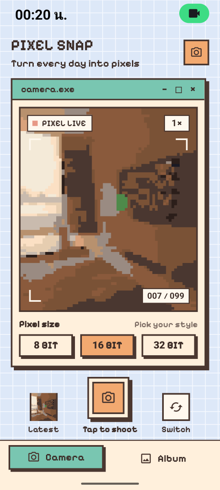
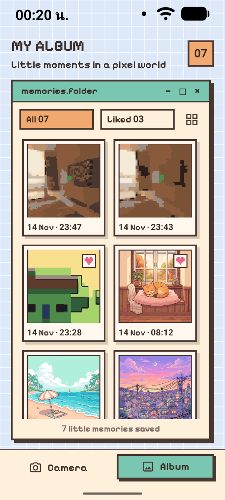
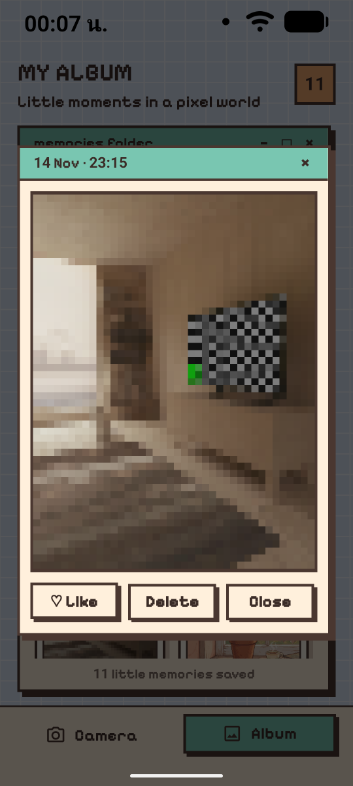

# Pixel Snap

แอปกล้องบน Android ที่เปลี่ยนภาพจากกล้องให้เป็น **พิกเซลอาร์ตสไตล์การ์ตูน** แบบสด ๆ ตั้งแต่ก่อนกดถ่าย
พร้อมอัลบั้มเก็บความทรงจำ หน้าตาแอปออกแบบเป็นธีมเรโทร หน้าต่างแบบ Windows 95 บนพื้นตารางสีฟ้า

> Term project วิชา **CS364** (ภาคเรียนที่ 1)

| ถ่ายรูป (`camera.exe`) | อัลบั้ม (`memories.folder`) | ดูรูปใหญ่ |
|:---:|:---:|:---:|
|  |  |  |

## ฟีเจอร์

**หน้าถ่ายรูป**
- ภาพสดจากกล้องถูกแปลงเป็นพิกเซลการ์ตูนทันที (ป้าย `PIXEL LIVE`)
- เลือกสไตล์ได้ 3 ระดับ
  - **8 BIT:** บล็อกใหญ่ 15 สี
  - **16 BIT:** บล็อกกลาง 23 สี
  - **32 BIT:** บล็อกเล็ก 33 สี
- ซูม 1× / 2× / 3× (ซูมจริงของกล้อง)
- สลับกล้องหน้า/หลัง กล้องหน้าแสดงภาพกลับซ้ายขวาเหมือนส่องกระจก
- กดถ่ายแล้วมีแฟลช ภาพค้างให้เห็นครู่หนึ่ง และบันทึกลงอัลบั้มทันที
- มีเสียง "ติ้ง" แบบเกมพิกเซลตอนกดถ่าย ดังตามปุ่มระดับเสียงสื่อ
- ตัวนับจำนวนรูป (สูงสุด 99 รูป) และปุ่มรูปล่าสุด กดแล้วไปหน้าอัลบั้ม

**หน้าอัลบั้ม**
- แท็บ **All** / **Liked** พร้อมจำนวนรูป
- สลับมุมมองได้ระหว่างกริด 2 คอลัมน์และรายการ
- แตะรูป = กดถูกใจหรือยกเลิก
- กดค้างที่รูป = เปิดดูรูปใหญ่ ซึ่งกดถูกใจหรือลบรูปได้ (มีหน้าต่างยืนยันก่อนลบ)
- มีภาพตัวอย่าง 6 รูปจากงานออกแบบติดมาให้ตั้งแต่ติดตั้ง

**อวาตาร์ตัวจิ๋ว (chibi)**
- ในหน้าดูรูปใหญ่ กด **★ Make avatar** แล้วใช้นิ้ววาดวงรอบตัวคนในรูปเพื่อตัดออกจากพื้นหลัง (`avatar.cut`)
- แอปต่อขาพิกเซลสั้น ๆ ให้ แล้วตัวละครจะเดินเล่นไปมาบนหน้าอัลบั้ม หยุดยืนเป็นพัก ๆ และหันกลับเมื่อถึงขอบ
- แตะตัวละคร = กระโดด (ย่อตัว → ลอยตัวยืด → ลงพื้น) พร้อมเสียงติ้ง
- กดค้างที่ตัวละคร = ลบอวาตาร์ (มีหน้าต่างยืนยัน)
- แตะตรงที่ไม่โดนตัวละครจะทะลุไปถึงการ์ดรูปข้างล่าง ใช้งานอัลบั้มได้ตามปกติ
- ไม่ใช้ ML หรือไลบรารีเพิ่ม: ตัดรูปด้วยการเติมสี `Path` ลง mask ขนาดเท่ารูปพิกเซล ทำให้ขอบเป็นขั้นบันไดพิกเซลเอง

## เทคโนโลยีที่ใช้

| ส่วน | ที่ใช้ |
|---|---|
| ภาษา / UI | Java, XML layouts, Fragments, RecyclerView |
| กล้อง | CameraX 1.4.2 (`ImageAnalysis`) |
| ฐานข้อมูล | SQLite ผ่าน `SQLiteOpenHelper` (`DBHelper`) |
| Android | minSdk 28 (Android 9), targetSdk / compileSdk 37 |
| Build | Gradle (Android Gradle Plugin 9.3.3) |

ทุกอย่างทำงานในเครื่องทั้งหมด **ไม่ใช้อินเทอร์เน็ตและไม่เรียก API ภายนอก**

## หลักการทำฟิลเตอร์พิกเซลการ์ตูน

CameraX ส่งภาพจากกล้อง (ประมาณ 640×480) มาให้ราว 30 เฟรมต่อวินาที แต่ละเฟรมผ่าน `Pixelator` ตามขั้นตอนนี้

```
เฟรมกล้อง
  → ย่อเหลือ 2 เท่าของขนาดสุดท้าย
  → ① เกลี่ยเรียบด้วย Kuwahara filter (ผิว/พื้นผิวเรียบเป็นก้อนสี แต่ขอบยังคม)
  → ย่อเป็นขนาดสุดท้าย กว้าง 40 / 64 / 96 พิกเซล
  → ② เพิ่มความสดของสี คอนทราสต์ และความสว่าง
  → ③ ปัดทุกพิกเซลให้เข้าจานสีที่กำหนด (มีสีผิวหลายระดับ)
  → ④ ลบจุดสีเดี่ยว ๆ ให้เป็นก้อนสีสะอาด
  → ⑤ ใส่เส้นขอบสีน้ำตาลเข้มตรงขอบวัตถุ
  → หมุนให้ตรง / กลับซ้ายขวาสำหรับกล้องหน้า
```

ภาพที่ได้มีขนาดเล็กมาก เวลาแสดงจะขยายแบบไม่เกลี่ยสี (nearest-neighbor) ทำให้เห็นเป็นบล็อกพิกเซลคม ๆ
รูปที่บันทึกคือเฟรมเดียวกับที่เห็นในช่องมองภาพตอนกดถ่ายพอดี

## ฐานข้อมูล

ไฟล์ `pixel_snap.db` (เวอร์ชัน 4) มี 2 ตาราง

```sql
CREATE TABLE memories (
    _id          INTEGER PRIMARY KEY AUTOINCREMENT,
    taken_at     INTEGER NOT NULL,            -- เวลาถ่าย (Unix time, มิลลิวินาที)
    is_favorite  INTEGER NOT NULL DEFAULT 0,  -- 1 = ถูกใจ
    image_base64 TEXT    NOT NULL             -- ไฟล์รูป (PNG/JPEG) แปลงเป็น Base64
);
CREATE INDEX idx_memories_taken_at ON memories (taken_at DESC);

CREATE TABLE avatars (
    _id           INTEGER PRIMARY KEY AUTOINCREMENT,
    created_at    INTEGER NOT NULL,           -- เวลาสร้าง (มิลลิวินาที)
    memory_id     INTEGER REFERENCES memories(_id) ON DELETE SET NULL,  -- รูปต้นฉบับ
    sprite_base64 TEXT    NOT NULL            -- ส่วนที่ตัดแล้ว (PNG โปร่งใส) แปลงเป็น Base64
);
```

- **ตาราง `avatars`:** เก็บแค่ส่วนที่ตัดออกมา ส่วนขาและเฟรมเดิน/กระโดดสร้างใหม่จากโค้ดตอนโหลด หน้าอัลบั้มแสดงตัวล่าสุด (`ORDER BY created_at DESC LIMIT 1`)
  - เปิด foreign key ใน `DBHelper.onConfigure()` ถ้าลบรูปต้นฉบับ `memory_id` จะกลายเป็น `NULL` แต่ตัวละครยังอยู่

- **การเก็บรูป:** แปลงรูปเป็นข้อความ ASCII ด้วย Base64 ก่อนบันทึก และแปลงกลับตอนแสดงผล ทุกภาพในแอปดึงจากฐานข้อมูล
- **CRUD อยู่ใน `MemoryRepository`:**
  - INSERT: ถ่ายรูป
  - SELECT: แสดงอัลบั้มและรูป
  - UPDATE: กดถูกใจ
  - DELETE: ลบรูป
  - อวาตาร์: INSERT ตอนกด Use this, SELECT ตอนเปิดแอป, DELETE ตอนกดค้างที่ตัวละคร
- **การอัปเกรด:** `DBHelper.onUpgrade()` ย้ายข้อมูลจากฐานข้อมูลเวอร์ชันเก่าให้อัตโนมัติ รูปของผู้ใช้ไม่หาย (v3 → v4 เพิ่มตาราง `avatars`)

## โครงสร้างโปรเจกต์

```
app/src/main/java/com/example/myapplication/
├── MainActivity.java           หน้าหลัก + แถบเมนูล่าง สลับระหว่าง 2 หน้า
├── camera/
│   └── CameraFragment.java     หน้าถ่ายรูป: CameraX, สิทธิ์กล้อง, ซูม, ถ่ายรูป
├── gallery/
│   ├── GalleryFragment.java    หน้าอัลบั้ม: แท็บ, กริด/รายการ, ถูกใจ
│   ├── MemoryAdapter.java      การ์ดรูปใน RecyclerView
│   └── PhotoViewerDialog.java  หน้าต่างดูรูปใหญ่ (ถูกใจ / ลบ / สร้างอวาตาร์)
├── avatar/
│   └── AvatarCutDialog.java    หน้าตัดรูปด้วยนิ้ว + ตัวอย่างอวาตาร์
├── data/
│   ├── DBHelper.java           SQLiteOpenHelper: สร้างตาราง, ข้อมูลตั้งต้น, อัปเกรด, Base64
│   ├── MemoryRepository.java   อ่าน/เขียนฐานข้อมูล (CRUD) + แคชรูป
│   ├── Memory.java             ข้อมูลรูป 1 แถว
│   └── Avatar.java             ข้อมูลอวาตาร์ 1 แถว
└── ui/
    ├── Pixelator.java          ฟิลเตอร์พิกเซลการ์ตูน
    ├── PhotoViews.java         แสดงรูปพิกเซลแบบขอบคม / ภาพว่าง
    ├── LassoCutView.java       วาดวงด้วยนิ้ว → mask → ตัดรูป
    ├── AvatarSprite.java       ต่อขา + สร้างเฟรมเดิน / ย่อตัว / ลอยตัว
    ├── AvatarView.java         ตัวละครเดินบนอัลบั้ม (state machine, การแตะ)
    ├── PixelFont.java          ฟอนต์พิกเซล
    └── GridBackgroundDrawable.java  พื้นหลังลายตาราง

app/src/main/res/
├── layout/   activity_main, fragment_camera, fragment_gallery, item_memory, dialog_photo_viewer, dialog_avatar_cut
├── drawable/ กรอบหน้าต่าง ปุ่ม และไอคอนแบบเรโทร (vector / shape)
├── font/     Silkscreen (หัวข้อ), Pixelify Sans (ข้อความ)
└── raw/      ภาพตัวอย่าง 6 รูป (ใส่ลงฐานข้อมูลตอนติดตั้ง)
```

## สิ่งที่เพิ่มในฟีเจอร์อวาตาร์ (branch `walk`)

เพิ่มเสียงชัตเตอร์ (จาก branch `soundAdd`) และอวาตาร์ chibi ที่เดินเล่นบนหน้าอัลบั้ม

**ไฟล์ใหม่**

| ไฟล์ | ทำอะไร |
|---|---|
| `avatar/AvatarCutDialog.java` | หน้าต่าง `avatar.cut`: โหลดรูป ให้วาดวงตัด โชว์ตัวอย่าง แล้วบันทึก |
| `ui/LassoCutView.java` | วาดวงด้วยนิ้ว → เทลง mask ขนาดเท่ารูปพิกเซล → ตัดและครอปให้พอดีตัว |
| `ui/AvatarSprite.java` | ย่อส่วนที่ตัดให้สูง 22 px, วาดขา, ใส่เส้นขอบ, สร้างเฟรมเดิน 4 เฟรม / ยืน / ย่อตัว / ลอยตัว |
| `ui/AvatarView.java` | ชั้นโปร่งใสทับอัลบั้ม: state machine เดิน ⇄ ยืน, แตะ = กระโดด, กดค้าง = ลบ, หยุดเองเมื่อซ่อนแท็บ |
| `data/Avatar.java` | ข้อมูลอวาตาร์ 1 แถว |
| `res/layout/dialog_avatar_cut.xml` | หน้าตาหน้าต่างตัดรูป |

**ไฟล์ที่แก้**

| ไฟล์ | แก้อะไร |
|---|---|
| `data/DBHelper.java` | DB v4: ตาราง `avatars`, เปิด foreign key ใน `onConfigure()`, `onUpgrade()` จาก v3 |
| `data/MemoryRepository.java` | `getAvatar()` / `saveAvatar()` / `deleteAvatar()` บน background thread และโหลดอวาตาร์ตอนเปิดแอป |
| `gallery/GalleryFragment.java` + `fragment_gallery.xml` | วาง `AvatarView` ทับรายการรูป, เสียงติ้งตอนกระโดด, หน้าต่างยืนยันการลบ |
| `gallery/PhotoViewerDialog.java` + `dialog_photo_viewer.xml` | ปุ่ม **★ Make avatar** |
| `values/strings.xml` | ข้อความของฟีเจอร์ใหม่ |

ในโค้ด จุดที่เพิ่มมีคอมเมนต์ `[ใหม่ - ฟีเจอร์อวาตาร์]` หรือ `[เพิ่ม - ฟีเจอร์อวาตาร์]` กำกับไว้

## วิธีรันโปรเจกต์

1. ติดตั้ง **Android Studio** เวอร์ชันล่าสุด (มี JDK มาให้แล้ว)
2. Clone โปรเจกต์
   ```bash
   git clone https://github.com/Nantapoparm/CS364_TermProject.git
   ```
3. เปิดโฟลเดอร์ใน Android Studio แล้วรอ **Gradle Sync** ให้เสร็จ
4. เลือกอุปกรณ์ แล้วกด **Run ▶**
   - **มือถือจริง:** Android 9 ขึ้นไป แนะนำ เพราะได้ทดสอบกล้องจริง
   - **Emulator:** ใช้กล้องจำลองได้

ครั้งแรกที่เปิดหน้ากล้อง แอปจะขอสิทธิ์ใช้กล้อง

## สิทธิ์ที่แอปใช้

| สิทธิ์ | ใช้ทำอะไร |
|---|---|
| `CAMERA` | แสดงภาพสดและถ่ายรูป |

รูปทั้งหมดเก็บในฐานข้อมูลส่วนตัวของแอปเท่านั้น ไม่ส่งออกนอกเครื่อง และแอปอื่นเข้าถึงไม่ได้

## เครดิต

- ฟอนต์ [Silkscreen](https://github.com/googlefonts/silkscreen) และ [Pixelify Sans](https://github.com/eifetx/Pixelify-Sans) ใช้ภายใต้ SIL Open Font License 1.1 (ดูในโฟลเดอร์ [`licenses/`](licenses/))
  - Pixelify Sans ถูกแยกเป็นไฟล์ Regular / Bold และตัดตัวเลข 0–9 ออก เพื่อให้ตัวเลขแสดงด้วยฟอนต์ปกติของระบบ
- ภาพตัวอย่าง 6 รูปมาจากงานออกแบบ UI ของโปรเจกต์

## ผู้จัดทำ

- _นายนันทภพ ชนชอบธรรม_
